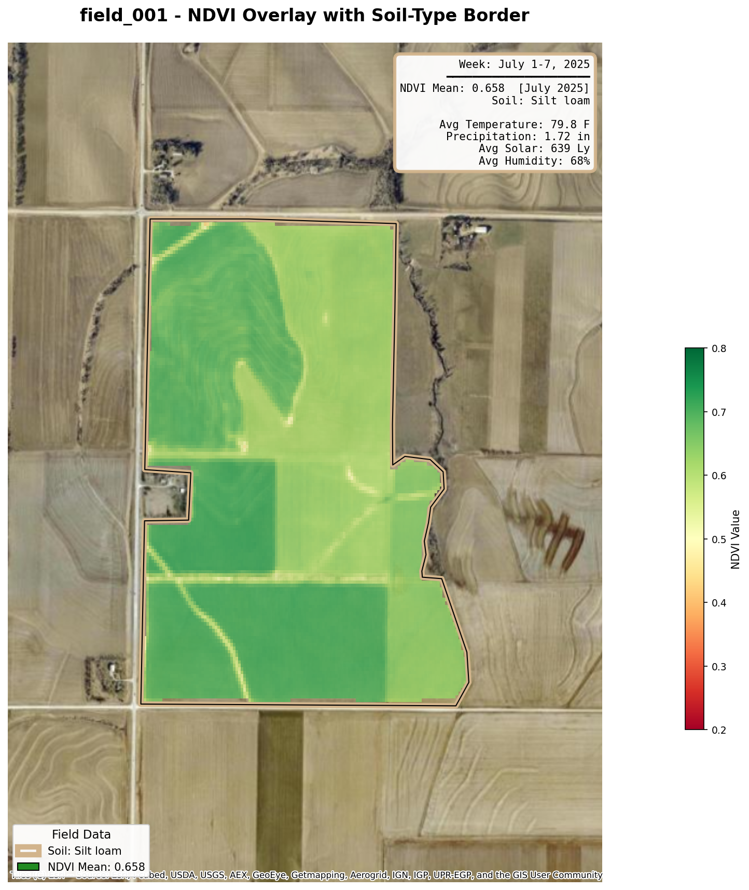
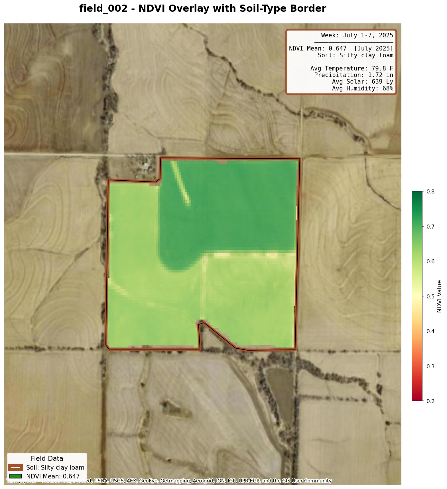
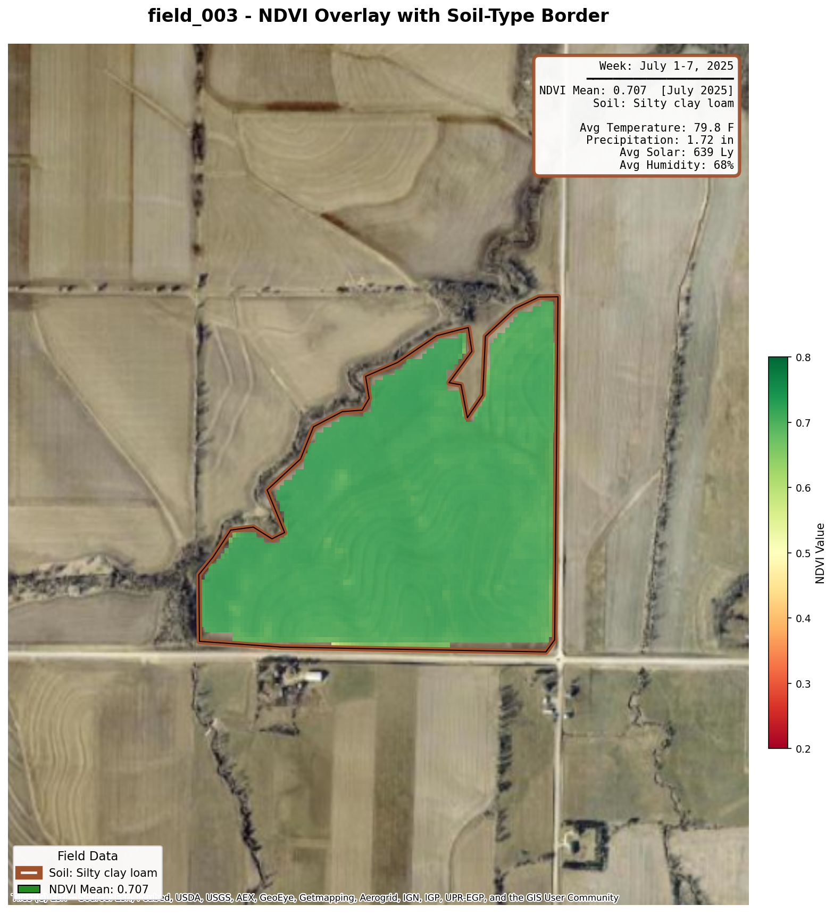
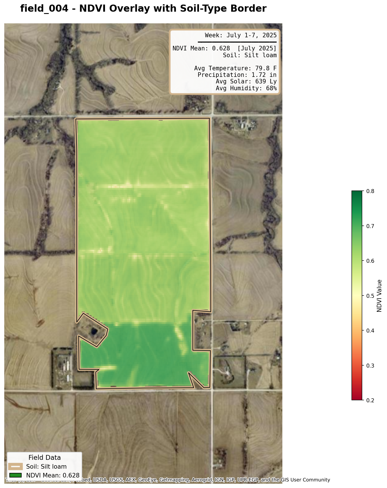
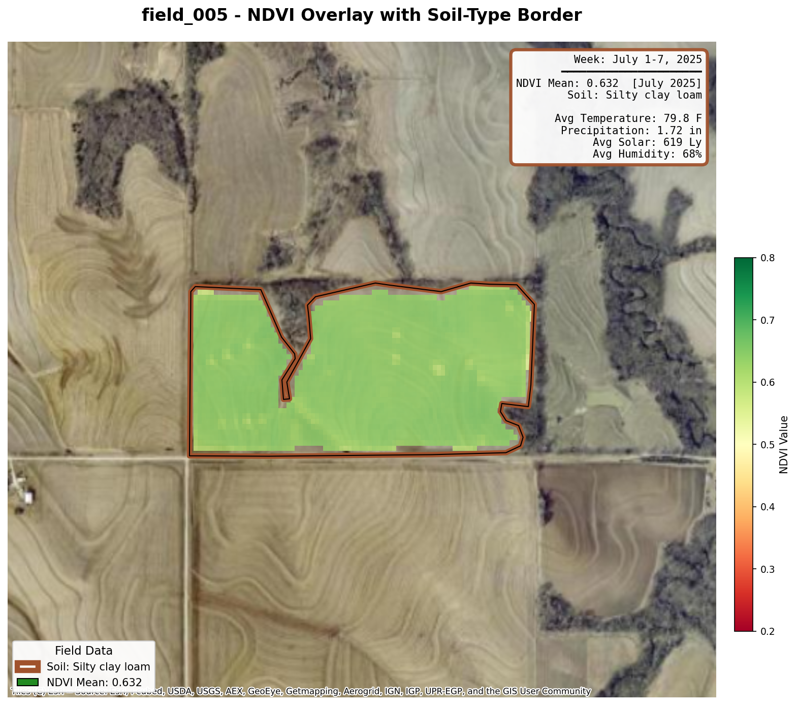

# Assignment 07: Spatial Data Integration

## Overview
This assignment integrates multiple spatial data sources to create comprehensive field maps for 5 agricultural fields in Nebraska. The integration combines field boundaries, soil data, weather data, and NDVI satellite imagery into unified visualizations.

## Data Sources
- **Field Boundaries**: GeoJSON from OpenStreetMap (EPSG:4326)
- **Soil Data**: NRCS soil database via SSURGO (CSV)
- **Weather Data**: NASA POWER (0.5° resolution, ~55km grid)
- **NDVI**: Sentinel-2 satellite imagery (July 2025)

## What We Did
1. Loaded and merged field boundaries with soil attributes
2. Integrated weather data (temperature, precipitation, solar radiation)
3. Extracted NDVI statistics from satellite imagery
4. Created individual field maps with satellite basemap, NDVI overlay, and weather info

## Technical Implementation

### Weather Data Note
- **Resolution**: NASA POWER data has 0.5° grid resolution (~55km)
- **All 5 fields fall within the same grid cell**, resulting in identical weather values
- **Weekly averages**: Calculated for July 1-7, 2025 (first week of July)
- **Units**: Imperial units (°F, inches, Langleys) used for display

### NDVI Clipping
- NDVI rasters are in EPSG:32614 (UTM Zone 14N)
- Field boundaries are in EPSG:4326 (lat/lon)
- **Process**: Reproject field boundary to UTM → Create mask → Apply AFTER reprojection to prevent overflow
- **NaN handling**: Custom numpy function used (scipy unavailable) to fill holes in NDVI rasters

### Field Map Components
- Esri World Imagery satellite base layer
- NDVI overlay clipped to exact field boundaries
- Soil-type colored borders
- Info box with weekly weather data (July 1-7, 2025)
- Legend showing soil type and NDVI mean

## Results

### Field 001 (Ely Silt Loam, 322.5 acres)
**Mean NDVI: 0.658**

### Field 002 (Colo Silty Clay Loam, 146.7 acres)
**Mean NDVI: 0.647**

### Field 003 (Colo Silty Clay Loam, 102.7 acres)
**Mean NDVI: 0.707**

### Field 004 (Kennebec Silt Loam, 290.6 acres)
**Mean NDVI: 0.628**

### Field 005 (Colo Silty Clay Loam, 70.7 acres)
**Mean NDVI: 0.632**

## Output Files
- `data/integrated_spatial_data.csv` - Combined tabular data
- `data/integrated_spatial_data.geojson` - Combined spatial data
- `assets/integrated_spatial_analysis/field_map_field_001.png` through `field_map_field_005.png` - Individual field maps

## Key Observations
1. **Weather is uniform**: All fields share identical NASA POWER data due to coarse resolution
2. **NDVI range**: 0.628 - 0.707 indicates healthy vegetation across all fields
3. **Soil types**: Ely, Colo, and Kennebec series with silt loam and silty clay loam textures
4. **Field sizes**: Range from 70.7 to 322.5 acres

## What the Maps Show
The integrated field maps display satellite imagery with NDVI vegetation indices overlaid. Higher NDVI values (green) indicate healthy, vigorous vegetation while lower values (yellow/red) may indicate stress or bare soil. The weather info boxes provide context for the week of July 1-7, 2025.
